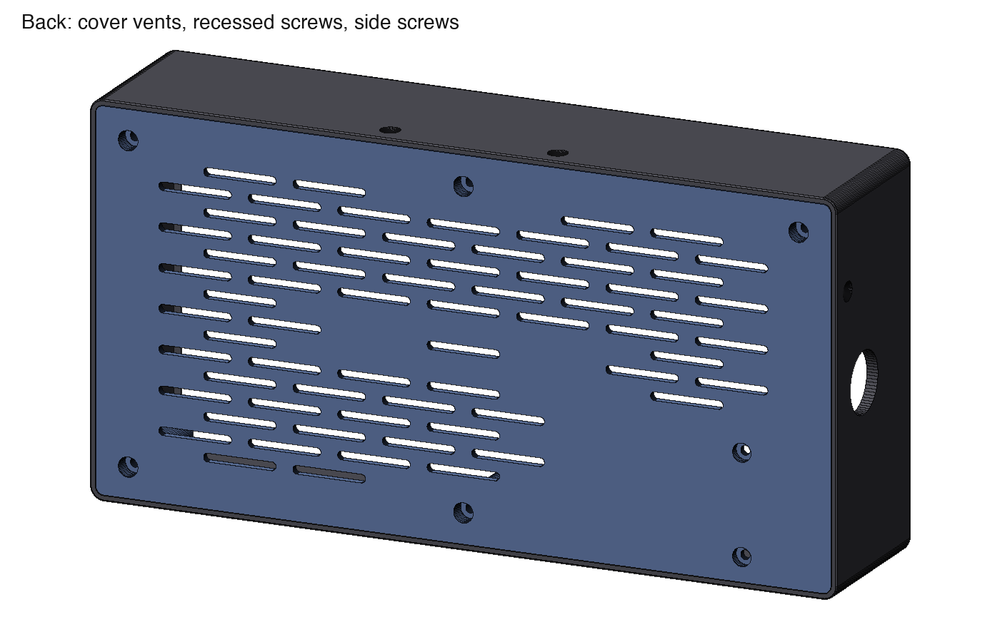

# flightportal
Project for displaying the details of planes overhead on an Adafruit MatrixPortal and LED matrix

(video sped up to make the file fit, the speeds and delays are configurable anyway)

https://user-images.githubusercontent.com/103124527/206902629-1f31bd41-d8a8-415e-a35a-625efb20b3d6.MOV

Uses an Adafruit MatrixPortal M4 and a 64x32 LED/RGB Matrix (P4), and some fairly hacked-together FlightRadar24 API-style scraping to display the details of flights passing overhead. That code being unofficial, it may break at any time!

## Hardware

1. A MatrixPortal M4 (https://www.adafruit.com/product/4745)
2. A P4, 64x32 RGB matrix panel (I get mine from Aliexpress)
3. The case I designed (https://www.thingiverse.com/thing:5701517)
4. An adafruit acrylic diffuser (https://www.adafruit.com/product/4749) - available various places
5. 6 M3 screws (about 8mm long, a little longer is OK, shorter is probably a problem)
6. Optional: Uglu dashes to stick the diffuser on, the case holds mine on pretty well though (https://www.protapes.com/products/uglu-600-dashes-sheets)

For power, the easiest thing is to use the cable that came with your matrix panel, as long as it has two prongs that go to the screws on the matrixportal. All that's needed is for the portal to connect to the power port on the panel - we're not using much power here (I clock it at about 2w). Any decent usb power supply connected to the portal should do it.


I soldered a connection straight onto the panel's power port as below, for neatness, but that's completely optional.


## Case v4 (one-piece shell + back cover)

An alternative enclosure in [`case/`](case/), remixed from the Thingiverse case above (CC-BY). It's a single-piece front shell that holds the diffuser behind a lip, plus a vented back cover that screws into the panel's own brass inserts, so nothing is taped and the panel can't shift. Nothing sticks into the shell's pocket, so the diffuser and panel drop straight in from the back. The MatrixPortal is mounted on the cover and connects to the panel with the ribbon cable, and USB comes in through a socket in the end of the case, so plugging and unplugging never strains the board. The case is 267.5 × 137.9 × 59.8 mm, with 4 mm walls so the corners stand up to knocks.



**Print files** (the mesh units are millimetres):

- FDM, PETG: `case/FlightPortal_v4_shell_FDM.stl` and `case/FlightPortal_v4_back_cover_FDM.stl`. Print the shell front face down and the cover outside face down. Neither needs supports. Use 4+ perimeters and 0.2 mm layers or finer. Infill can be 20%. PETG is better than PLA here because the snap clips flex and the panel gets warm.
- MJF, PA12 nylon: `case/FlightPortal_v4_shell.stl` and `case/FlightPortal_v4_back_cover.stl`. These give a nicer finish, but cost a lot more.

**Extra parts** (besides the MatrixPortal, panel, diffuser and the panel's ribbon and power cables):

- [Adafruit 4218 panel-mount USB-C cable](https://www.adafruit.com/product/4218)
- [Adafruit 400 extra-long male header](https://www.adafruit.com/product/400). Snap off two 8-pin strips and glue them side by side to make a 2x8 that joins the ribbon to the MatrixPortal's socket.
- 5 × M3×40 pan head or socket head screws (through the cover's standoffs into the panel)
- 7 × M3×10 metric countersunk screws (90° heads, not US 82° flat heads; through the shell's side walls into blocks on the cover)
- 2 × metal M3×6 pan head screws (cover to the MatrixPortal's 5V/GND standoffs; the heads sit below the cover's surface, so no live metal stands proud)
- 2 small zip ties for the cable slack

**Assembly:**

1. Lay the shell front face down and drop in the diffuser, then the panel.
2. Fit the USB-C socket through the end wall and tighten its nut on the inside, in the space behind the panel. Do this after the panel, because the socket's body sticks into the pocket.
3. On the cover, sit the power-cable lugs on the MatrixPortal's standoffs with their wires pointing off the end of the board, toward the end wall. Press the board into the two clips, then fit the two M3×6 screws from outside, through the lugs into the standoffs.
4. Connect the ribbon through the header. Plug the USB-C cable into the board and zip-tie the slack to the cover.
5. Lower the cover on, so its 7 screw blocks slide down inside the shell walls. Fit the 5 long panel screws from the outside of the cover, down the standoffs into the panel. Their heads sit in shallow recesses, so any small screwdriver reaches them.
6. Fit the 7 countersunk screws from outside, through the holes in the shell's top, bottom and end walls into the blocks.

The 7 side screws cut their own threads in the plastic, so stop once they're snug. To fit a different panel, header or printer, change the measurements at the top of `case/build_case.py` and run `python case/build_case.py case` (add `--fdm` for the FDM version). It needs `numpy`, `trimesh` and `manifold3d`.

## Setup

1. Install CircuitPython on the MatrixPortal as described in https://learn.adafruit.com/adafruit-matrixportal-m4/install-circuitpython. It shows up as a `CIRCUITPY` drive when plugged in over USB.
2. Copy `code.py`, `json_filter.py`, `clock.py`, `themes.py`, `ICAO.csv` and `settings.toml` to the `CIRCUITPY` drive.
3. Edit `settings.toml` on the drive: add your WiFi name and password, and set `BOUNDS_BOX` to the area you want to watch (top latitude, bottom latitude, left longitude, right longitude). The rest is optional:
   - `MAX_ALTITUDE` skips flights above that height; otherwise the lowest flight in the box is shown.
   - `UTC_OFFSET` and `DST_RULE` set your time zone, which turns on a clock (time and date) when no flight is overhead. `SHOW_CLOCK` and `CLOCK_24H` control it, and `SECONDS_RING` fills the edge of the display over each minute like a second hand. `SHOW_COUNT` shows how many planes have been shown today in the top-right corner, and `SHOW_TEMP` the outside temperature in the top-left (`TEMP_UNIT` "C" or "F"; from open-meteo.com for the middle of `BOUNDS_BOX`, checked every 30 minutes).
   - The plane animation flies the way the real plane is heading, east to the right as on a map. Set `FLIP_PLANE_DIRECTION = "True"` if your display faces north (east on your left).
   - `NIGHT_START` and `NIGHT_END` (hours, local time) pause flight lookups overnight and show a dim clock, or turn the display off with `NIGHT_CLOCK = "False"`.
   - `THEME` picks a colour theme: `"classic"`, `"christmas"`, `"halloween"`, `"thanksgiving"`, `"july4"`, `"newyear"` or `"valentines"`, or `"auto"` to follow the calendar (dates are in `AUTO_THEMES` in `themes.py`). Holiday themes add pixel-art decorations to the flight display (holly, Santa and candy canes; a pumpkin, bat and ghost; a turkey and maple leaves; a flag and fireworks; fireworks and champagne; hearts) and snow or confetti drifting behind the clock. Themes and their art live in `themes.py` if you want to add your own.
   - `STATUS_LEDS` turns the status LED on or off.

If WiFi always fails on the first connect attempt after a restart, the board's ESP32 WiFi firmware is probably old (the boot log prints its version). Updating it is covered in Adafruit's [Upgrading AirLift ESP32 Firmware](https://learn.adafruit.com/upgrading-esp32-firmware) guide; version 3.x works well.
4. Install the libraries. The easiest way is [circup](https://github.com/adafruit/circup), which reads the imports and installs what's needed:

   ```
   pip install circup        # or: uvx circup ...
   circup install --auto
   circup update --all       # later, to keep libraries current
   ```

   The libraries used are adafruit_matrixportal, adafruit_esp32spi, adafruit_requests, adafruit_display_text, adafruit_bitmap_font and neopixel, plus their dependencies.

The board restarts and runs the new code whenever you save a file to the drive.

## Customising

Layout, colours, speeds and which flight details are shown are configurable near the top of `code.py`. To show another field from FlightRadar24, add its path to `DETAIL_FIELDS` (only those fields are kept, to save memory) and read it in `parse_details_json()`.

`ICAO.csv` maps aircraft type codes to friendly names for the third row (e.g. `B738` shows as "Boeing 737-800"). Add a line for any type you see that isn't listed; unlisted types fall back to FlightRadar24's model name.

## Debugging

The board prints what it's doing over USB serial at 115200 baud: each search result, flight lookups, errors and why it last restarted.

- **Mac:** `screen /dev/cu.usbmodem* 115200` (exit with Ctrl+A then K), or the serial console in Mu.
- **Windows:** find the COM port in Device Manager and connect with PuTTY or Mu.

To keep a timestamped log for days (useful for catching rare failures), run the logger from this repo on a computer the board is plugged into:

```
uv run --with pyserial python tools/serial_logger.py logs
```

It writes one file per day to `logs/`, reconnects if the board restarts, and adds a warning line if the board goes quiet for 15 minutes. Useful things to search for: `grep -E "WARNING|failed|Error|Reset reason" logs/*.log`.

`tools/test_json_filter.py` and `tools/test_clock.py` test the response filter and the clock/time zone maths on a computer: `python3 tools/test_json_filter.py`.
